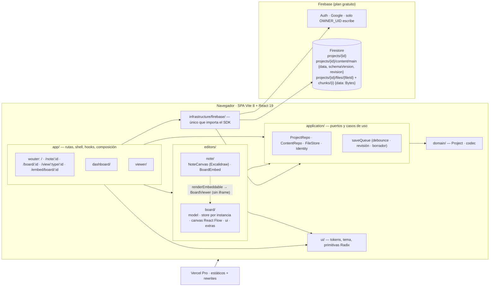

# Arquitectura — drawyourarquitecture

Contratos, invariantes y modelo de datos: `docs/plan.md` (fuente única). Stack y estructura: `docs/stack.md`.

## Regla de dependencia
`domain ← application ← infrastructure`; `editors` y `app` consumen `application`/`domain`; solo `app/` conecta las implementaciones (`app/services.ts`). La regla la impone ESLint (`no-restricted-imports`).

SOLID sin ceremonia:
- **S**: repo de proyectos ≠ repo de contenido ≠ archivos ≠ cola de guardado ≠ editor.
- **O**: los nodos se registran en `nodeTypes`; un tipo nuevo no toca el canvas.
- **L/I**: puertos pequeños (`ContentRepo` = `load` + `save` con revisión esperada).
- **D**: editores y pantallas dependen de puertos; Firebase se inyecta desde `app/`. En la fase 2, la colaboración en tiempo real se monta como otra implementación del puerto de contenido (por ejemplo, Yjs), sin tocar los editores.

## Seguridad
- Solo el `OWNER_UID` crea y escribe. Lo público se lee con `get`, nunca con `list`. `ownerId` y `type` son inmutables, los campos van en lista cerrada y la `revision` es monótona.
- Sin Storage: las imágenes viven en Firestore, en trozos de ≤ 900 000 bytes bajo `projects/{id}/files/{fileId}`. La lectura hereda la del proyecto (dueño o público, con `get()` al padre) y la escritura es solo del dueño, con campos cerrados, `mimeType` png/jpeg/gif/webp (nunca SVG) y hasta 4 MiB. Toda imagen se optimiza (WebP, ≤ 2048 px) antes de subirla; no hay URLs públicas ni con token.
- Si una nota pública incrusta un board privado, el embed muestra «Diagrama privado».

## Embed de board en nota
`validateEmbeddable` devuelve `true` solo para el mismo origen con `/embed/board/<id>`. `renderEmbeddable` pinta `<BoardEmbed/>` con `BoardViewer` de solo lectura y un store propio. Se descarta el iframe porque el sandbox de Excalidraw dejaría el board sin sesión. Los boards no incrustan notas, así que no hay ciclos.
