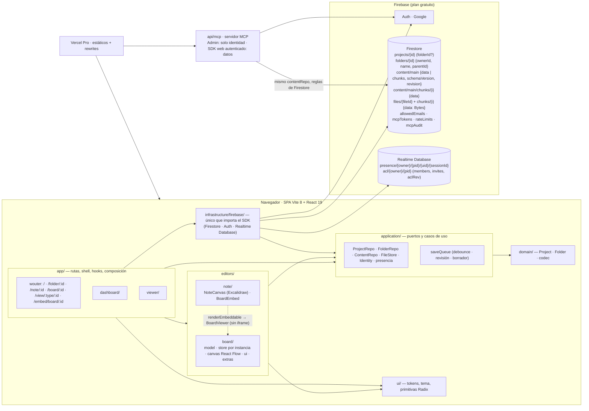

# Arquitectura — drawyourarquitecture

Contratos, invariantes y modelo de datos: `docs/plan.md` (fuente única). Stack y estructura: `docs/stack.md`.

## Regla de dependencia
`domain ← application ← infrastructure`; `editors` y `app` consumen `application`/`domain`; solo `app/` conecta las implementaciones (`app/services.ts`). La regla la impone ESLint (`no-restricted-imports`).

SOLID sin ceremonia:
- **S**: repo de proyectos ≠ repo de contenido ≠ archivos ≠ cola de guardado ≠ editor.
- **O**: los nodos se registran en `nodeTypes`; un tipo nuevo no toca el canvas.
- **L/I**: puertos pequeños (`ContentRepo` = `load` + `save` con revisión esperada + `subscribe`).
- **D**: editores y pantallas dependen de puertos; Firebase se inyecta desde `app/`. La colaboración en tiempo real (fase 2) es `ContentRepo.subscribe` + fusión por elemento inyectada por editor, sin tocar el puerto de guardado; la presencia es otro puerto con su adaptador en Realtime Database.

## Contenido troceado
`content/main` guarda `data` hasta 900 000 bytes (un documento de Firestore admite 1 MiB). Por encima guarda `chunks: n` (2 ≤ n ≤ 12, sin `data`) y los trozos van en `content/main/chunks/{i}`; meta y trozos se escriben en una transacción con la revisión esperada y los trozos sobrantes de un guardado más largo se borran. Tope práctico: 8 MiB (`MAX_CONTENT_BYTES`). Hay una sola implementación del puerto (`createContentRepo`, `infrastructure/firebase/contentRepo.ts`) con la parte pura en `application/contentChunks.ts`; la usan la app (`content.ts`) y el servidor MCP (`src/server/tools.ts`), cada uno con su cliente de Firestore.

## Presencia y cursores
Viven en Realtime Database, no en Firestore (cada cursor sería una escritura de cuota): `presence/{ownerId}/{projectId}/{uid}/{sessionId} = { name, color, x?, y?, at }` (un nodo por pestaña, un avatar por uid), con `onDisconnect().remove()` y el cursor con throttle de 80 ms. RTDB no lee Firestore, así que el dueño publica un espejo de acceso bajo su propio uid, `acl/{ownerId}/{projectId}/{members, invites}` versionado con `aclRev` (las reglas rechazan versiones anteriores); solo él escribe bajo esa rama (nadie puede reclamar el proyecto de otro) y un invitado se registra a sí mismo con el token de una invitación vigente. Firestore sigue siendo la fuente de verdad. Reglas en `database.rules.json`. Sin `VITE_FIREBASE_DATABASE_URL` la presencia se apaga.

## Servidor MCP
`api/mcp` (empaquetado en `api/_mcp.mjs`) identifica la petición con Admin (token → uid, `createCustomToken`) y opera con el SDK web de Firebase autenticado como esa persona (`src/server/userDb.ts`): las reglas de Firestore aplican tal cual y no hay autorización duplicada. Límite de tasa (`rateLimits`) y auditoría (`mcpAudit`) los escribe la propia persona bajo reglas. Detalle en `docs/mcp.md`.

## Carpetas
Cada persona organiza **sus** proyectos en carpetas anidadas (`folders/{id} = { ownerId, name, parentId: string | null, createdAt, updatedAt }`; el nombre va recortado, 1–40 caracteres; en pantalla, chips, migas y título con ancho máximo y elipsis). El proyecto lleva `folderId?: string | null` (ausente o `null` = Inicio) y solo su dueño lo cambia; los compartidos conmigo siguen en su sección, sin carpetas. Las reglas dejan leer, crear (con `canCreate()`), renombrar, mover y borrar una carpeta solo a su `ownerId` (inmutable, campos en lista cerrada); la lista se pide con `where('ownerId', '==', uid)` y se ordena en cliente, así que no hay índice compuesto. Que una carpeta esté vacía antes de borrarla y que no haya ciclos al moverla lo cuida el cliente (`canMove` en `domain/folder.ts`; las reglas no cuentan documentos de otra colección). Una carpeta cuyo padre ya no existe, o un proyecto cuya carpeta ya no existe, cuelgan de Inicio: nunca quedan invisibles. La ruta `/folder/:id` reutiliza el panel (`Dashboard` con `folderId`): migas, chips de subcarpetas, sus proyectos y, en lugar de las tarjetas «Nuevo», dos botones compactos «Nota» y «Diagrama» que crean con su `folderId`. Los proyectos y carpetas se mueven también arrastrando sobre un chip o un tramo de las migas, y «Volver al panel» regresa a la carpeta de origen (`history.state.from`, o la carpeta del proyecto). El servidor MCP no cambia: sus proyectos nuevos van a Inicio.

## Seguridad
- Crean proyectos el `OWNER_UID` y las cuentas con correo verificado en `allowedEmails/{correo}` (`canCreate()`); escriben el dueño y los editores invitados (`members`). Lo público se lee con `get`, nunca con `list`. `ownerId` y `type` son inmutables, los campos van en lista cerrada y la `revision` es monótona.
- Sin Storage: las imágenes viven en Firestore, en trozos de ≤ 900 000 bytes bajo `projects/{id}/files/{fileId}`. La lectura hereda la del proyecto (dueño o público, con `get()` al padre) y la escritura es solo del dueño, con campos cerrados, `mimeType` png/jpeg/gif/webp (nunca SVG) y hasta 4 MiB. Toda imagen se optimiza (WebP, ≤ 2048 px) antes de subirla; no hay URLs públicas ni con token.
- Si una nota pública incrusta un board privado, el embed muestra «Diagrama privado».
- Los trozos del contenido heredan la lectura del proyecto (`get`); `list` de trozos es del dueño. `mcpTokens`, `rateLimits` y `mcpAudit` son por persona (solo lo propio).

## Embed de board en nota
`validateEmbeddable` devuelve `true` solo para el mismo origen con `/embed/board/<id>`. `renderEmbeddable` pinta `<BoardEmbed/>` con `BoardViewer` de solo lectura y un store propio. Se descarta el iframe porque el sandbox de Excalidraw dejaría el board sin sesión. Los boards no incrustan notas, así que no hay ciclos.
